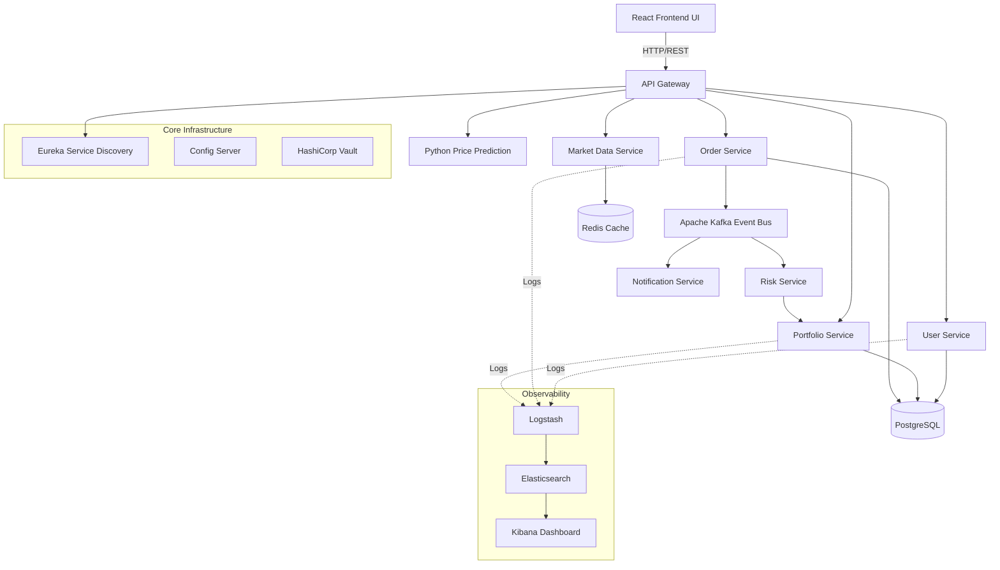
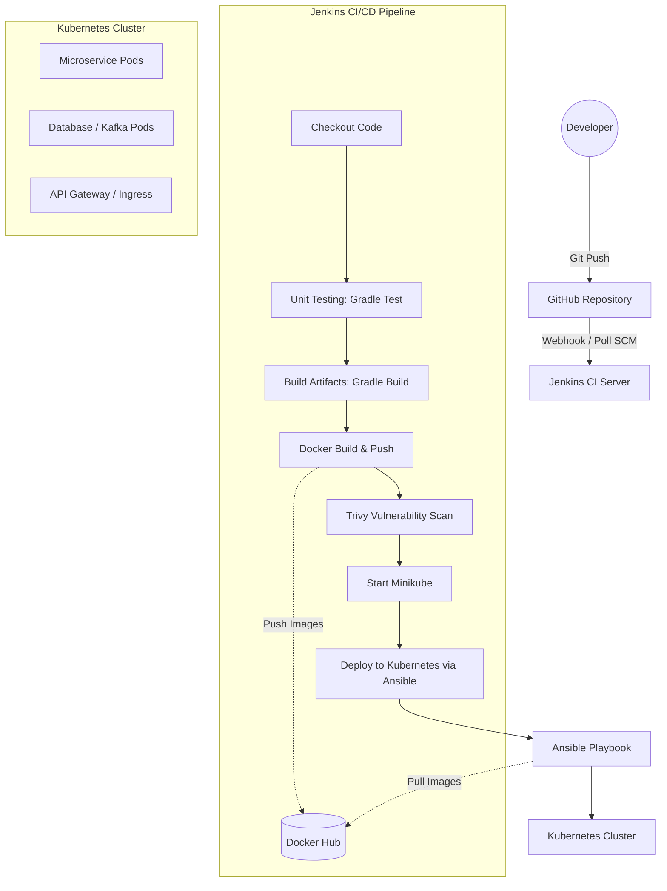

# SPE Major Project FinTech DevOps Architecture

This document provides a comprehensive overview of the SPE Major Project FinTech Stock System, including a detailed breakdown of all microservices, infrastructure components, and the end-to-end DevOps CI/CD pipeline.

## 1. System Services Overview

The system is built using a modern microservices architecture, encompassing various technologies optimized for their specific tasks.

### 1.1 Java Microservices (Spring Boot)
These services form the core backend of the trading platform.
*   **`api-gateway`**: Acts as the single entry point for all client requests, handling routing and load balancing.
*   **`config-server`**: Centralized configuration management for all microservices.
*   **`eureka-server`**: Service registry for dynamic service discovery.
*   **`user-service`**: Manages user authentication, registration, and user profiles.
*   **`portfolio-service`**: Manages user holdings, balances, and portfolio history.
*   **`market-data`**: Provides real-time and historical stock market data.
*   **`order-service`**: Handles the execution of buy and sell orders.
*   **`risk-service`**: Assesses trade risks, validates user balances, and ensures trading compliance.
*   **`notification-service`**: Manages alerts and user notifications (e.g., successful trades).

### 1.2 Python Services
*   **`price-prediction`**: Utilizes machine learning models to provide predictive analytics for future stock prices.

### 1.3 React Frontend
*   **`frontend-react`**: The user-facing Institutional Trading Terminal, providing an interactive UI for trading, viewing portfolios, and analyzing market trends.

### 1.4 Supporting Infrastructure
*   **Postgres (`db`)**: Primary relational database storing user, order, and portfolio data.
*   **Redis**: In-memory data store used for caching to improve read performance.
*   **Kafka & Zookeeper**: Event streaming platform used for asynchronous communication between microservices (e.g., order processing).
*   **HashiCorp Vault**: Securely stores and manages sensitive secrets and credentials.
*   **ELK Stack (`elk`)**: 
    *   **Elasticsearch**: Search and analytics engine for logs.
    *   **Logstash**: Data processing pipeline that ingests data from multiple sources.
    *   **Kibana**: Data visualization dashboard for monitoring system logs and metrics.

---

## 2. System Architecture Flowchart

---

## 3. DevOps CI/CD Pipeline

The project utilizes a fully automated CI/CD pipeline managed by Jenkins. The pipeline handles code checkout, testing, building, security scanning, containerization, and orchestration via Kubernetes and Ansible.

### Pipeline Stages Breakdown
1.  **Checkout**: Pulls the latest code from the `main` branch of the GitHub repository.
2.  **Unit Testing**: Executes Java unit tests via Gradle (`./gradlew test`) for all Spring Boot microservices.
3.  **Build**: Compiles the source code and builds the executable artifacts for Java services.
4.  **Docker Build & Push**: 
    *   Builds Docker images for all 9 Java microservices, the Python service, and the React frontend.
    *   Pushes the built images to Docker Hub (`ashwins1/spe-stocksys-mjproj`) with the `spestocksys-<service-name>` tag.
5.  **Trivy Security Scan**: Scans all built Docker images for `HIGH` and `CRITICAL` vulnerabilities using Aqua Security's Trivy.
6.  **Infrastructure Provisioning**: Starts Minikube to prepare the local Kubernetes cluster environment.
7.  **Kubernetes Deployment (Ansible)**: Executes an Ansible playbook (`ansible/playbook.yml`) which applies the Kubernetes manifests to deploy all services, databases, and configuration elements into the Minikube cluster.

---

## 4. DevOps CI/CD Flowchart 

